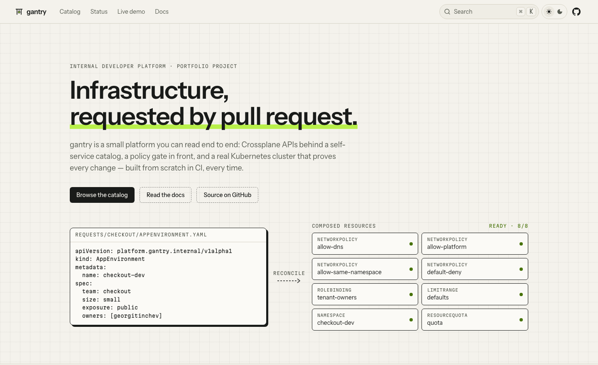
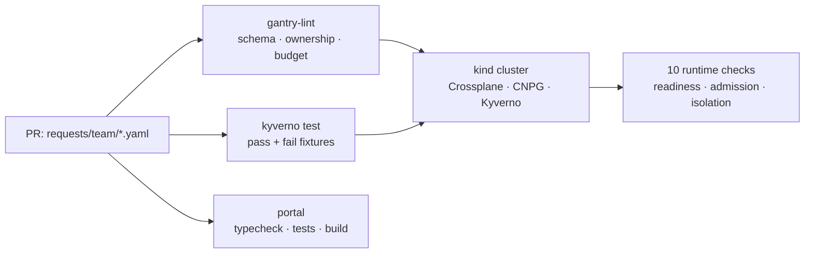

<h1>gantry</h1>

**Infrastructure, requested by pull request.**

[](https://github.com/georgitinchev/gantry/actions/workflows/ci.yml)
[](https://github.com/georgitinchev/gantry/actions/workflows/nightly.yml)
[](LICENSE)

gantry is a small internal developer platform you can read end to end: a
self-service **catalog**, **Crossplane** APIs behind it, a layered **policy gate**
in front of it, and a real Kubernetes cluster that **proves** every change —
built from scratch in CI, every time.

<picture>
  <source media="(prefers-color-scheme: dark)" srcset="docs/assets/portal-dark.png">
  
</picture>

## What happens on every pull request



The e2e suite doesn't stop at "it applied". It asserts that:

- every request reaches `Ready`
- Pod Security `restricted` and Kyverno reject non-compliant pods, each tested on its own
- a large environment without an approver is refused at admission
- pods in the same namespace reach Postgres, and **traffic from another tenant is dropped** by NetworkPolicy

## What you can request

| Offering | Kind | Backed by |
|---|---|---|
| App environment | `AppEnvironment` (cluster-scoped) | Namespace, ResourceQuota, LimitRange, default-deny NetworkPolicies, owner RoleBinding |
| PostgreSQL | `PostgresInstance` (namespaced) | CloudNativePG `Cluster` plus a scoped NetworkPolicy |

```yaml
# requests/checkout/postgres-orders.yaml
apiVersion: platform.gantry.internal/v1alpha1
kind: PostgresInstance
metadata:
  name: orders
  namespace: checkout-dev
spec:
  size: small
  version: "17"
```

## Repository layout

| Path | What lives there |
|---|---|
| `platform/apis/` | XRDs and Composition pipelines (`function-go-templating`, `function-auto-ready`) |
| `platform/rbac/` | the exact rights Crossplane needs to compose plain Kubernetes resources |
| `policy/kyverno/` | CEL `ValidatingPolicy` admission rules and their unit tests |
| `tools/lint/` | **gantry-lint**, a Go validator that reads the XRDs directly |
| `requests/` | what teams have asked for, one directory per team |
| `tests/e2e/` | runtime assertions against a live cluster |
| `portal/` | Next.js + Fumadocs portal: catalog generated from the XRDs, status, live demo, docs |
| `docs/` | architecture, guides, runbooks and ADRs, rendered by the portal and readable on GitHub |
| `hack/` | bootstrap, verification, snapshot and demo scripts |

## Run it locally

You need Docker, kind, kubectl, Helm, Go and Node.

```bash
make fresh     # create a kind cluster, install the platform, run e2e
make lint      # gantry-lint on requests/
make test      # Go + portal unit tests
make portal    # http://localhost:3000
```

With container images already pulled, the platform installs in about 75 seconds locally;
the first run takes longer while images download. On colima, raise inotify limits first:
`colima ssh -- sudo sysctl -w fs.inotify.max_user_instances=8192 fs.inotify.max_user_watches=1048576`.

## Design decisions

- [ADR 0001: CI-only runtime](docs/adr/0001-ci-only-runtime.md). There's no long-running cluster; every run starts from zero.
- [ADR 0002: Crossplane v2 direct composition](docs/adr/0002-crossplane-v2-direct-composition.md). No provider-kubernetes in the core.
- [ADR 0003: Validate in layers](docs/adr/0003-validation-in-layers.md). Lint, policy tests, admission and runtime checks.
- [ADR 0004: A small mock cloud](docs/adr/0004-own-mock-cloud.md). Networks, IPs and VMs through a custom provider (in progress).

## Status

| Layer | State |
|---|---|
| Platform APIs, policy gate, kind e2e | done |
| Portal, catalog, docs, status page | done |
| Live demo (GitHub sign-in, rate-limited) | done, enabled on deployment |
| Observability + alert-tested runbooks | next |
| Mock cloud + custom Crossplane provider | next |
| Nightly failure injection | next |

---

gantry is a personal project built from scratch on open-source components.
It isn't affiliated with any employer and doesn't run production workloads.
