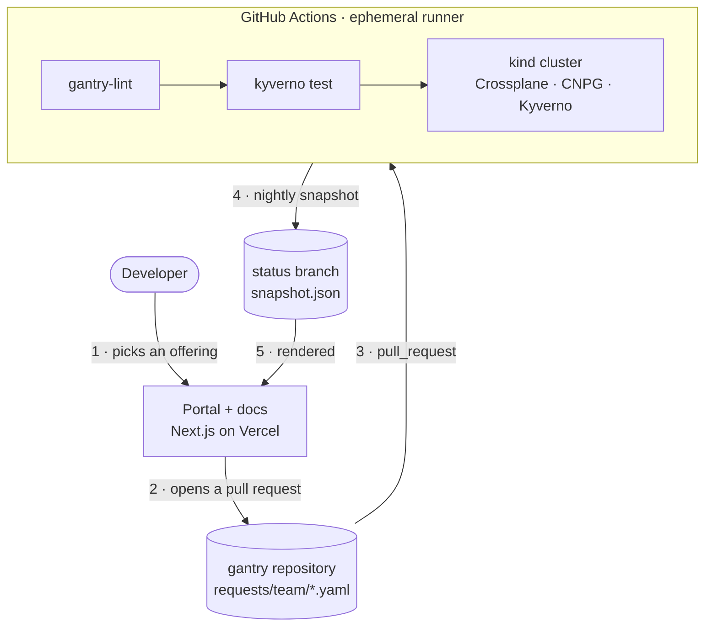
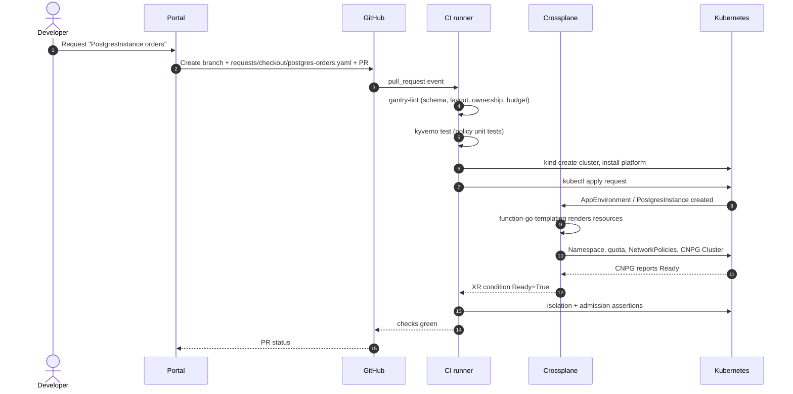
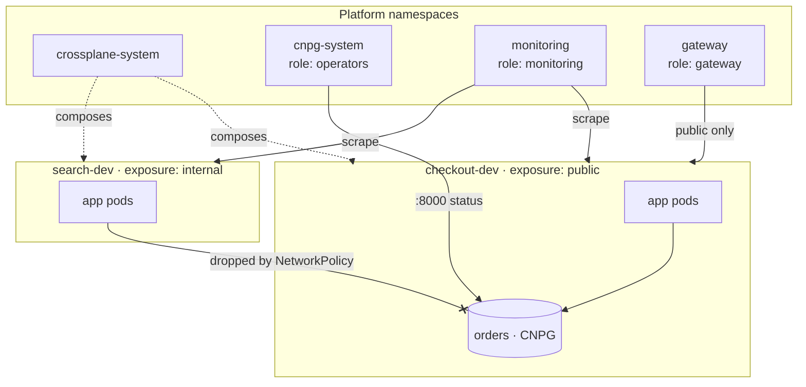
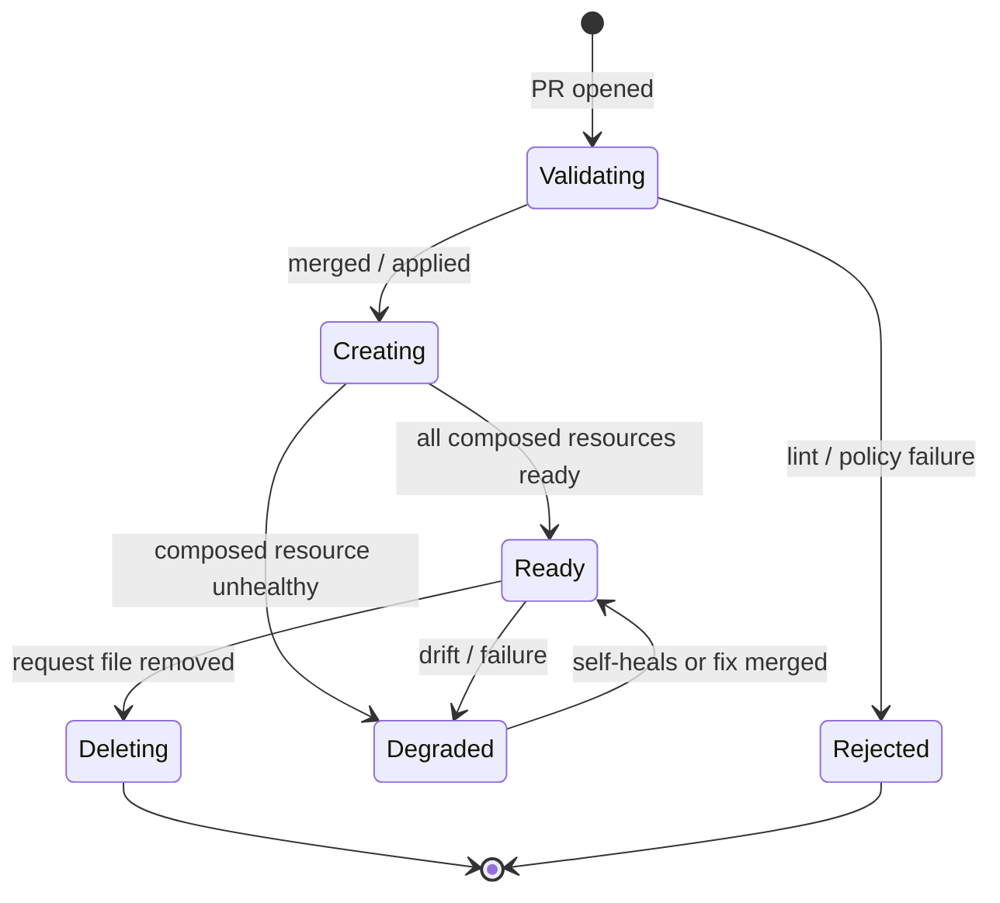

gantry is a small internal developer platform. Teams ask for infrastructure by
opening a pull request; the platform validates it in layers, proves it on a real
cluster, and reports the result back to the portal.

## System context

There is no long-running cluster. Every pull request, every night and every
live demo builds the platform from scratch on a GitHub-hosted runner and throws it
away afterwards. See [ADR 0001](/docs/adr/0001-ci-only-runtime).

## Request lifecycle

## Inside the cluster

Every tenant namespace starts with `default-deny` for ingress and egress. Allowed
paths are added explicitly: same-namespace traffic, DNS to `kube-system`,
scraping from `monitoring`, and — only for `exposure: public` — traffic from
the `gateway` namespace. The e2e suite proves the crossed-out edge is actually
dropped, not just declared.

## Resource state

