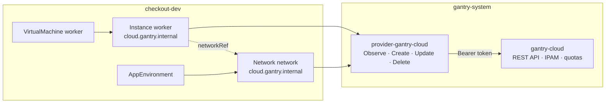

Real platform teams wrap a cloud. To keep gantry free and self-contained, it
ships its own: **gantry-cloud**, a Go service with a REST API, and
**provider-gantry-cloud**, a Crossplane provider built on `crossplane-runtime`
v2. See [ADR 0004](/docs/adr/0004-own-mock-cloud).

## gantry-cloud

| Endpoint | Behaviour worth testing against |
|---|---|
| `POST /v1/networks` | next free `/24` from `10.40.0.0/16`, or an explicit CIDR checked for overlap |
| `POST /v1/instances` | IP from the network (from `.10`), account quota, **asynchronous** `provisioning → running` |
| `PATCH /v1/instances/{id}` | resize only while running; passes through `resizing` |
| `DELETE /v1/networks/{id}` | refused with `409 in_use` while instances exist |
| duplicate names | `409 conflict` that **returns the existing object** so clients can adopt it |
| `PUT /admin/faults` | inject a 503 error rate and latency into write calls |
| `GET /metrics` | requests by route and code, instances by state |

## provider-gantry-cloud

Two namespaced managed resources, `Network` and `Instance`, reconciled by
crossplane-runtime's managed reconciler.

- **External name = cloud ID**, assigned on create. The default
  "name as external name" initializer is turned off, because a guessable name
  isn't an ID.
- **Idempotent create.** Cloud names are `<namespace>.<name>`. If the
  external-name write is lost after a successful create, the next create gets
  `409 conflict` with the existing object and adopts it instead of leaking a
  duplicate.
- **References.** An `Instance` names its `Network`; create waits (with
  backoff) until the network has a cloud ID.
- **Drift.** `size` is compared on every observe. A change resizes in place
  and is retried until the instance is running.
- **Deletes** tolerate `404`. Deleting a network that still has instances
  retries until they're gone.

All of it has unit tests with a fake cloud. The nightly drill turns on a 60%
error rate for writes and checks that a VM still converges.
