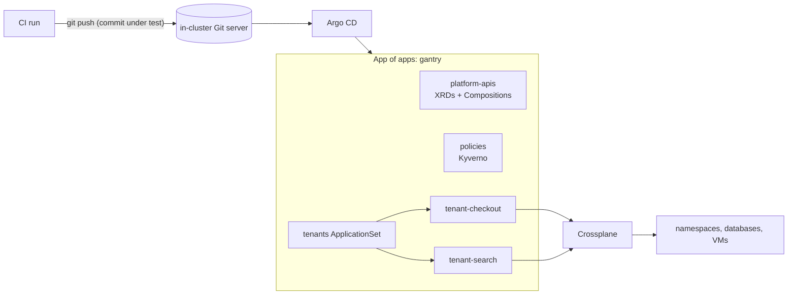

Requests are never applied by hand. Argo CD pulls them from Git and keeps the
cluster equal to it. See [ADR 0006](/docs/adr/0006-gitops-in-the-throwaway-cluster)
for why the Git server lives inside the cluster.

## Applications

| Application | Source | Notes |
|---|---|---|
| `gantry` | `gitops/apps` | app of apps |
| `platform-apis` | `platform/apis` | sync wave 0 |
| `policies` | `policy/kyverno` | sync wave 0, test fixtures excluded |
| `tenant-<team>` | `requests/<team>` | generated per directory by the `tenants` ApplicationSet |

Every Application syncs automatically, prunes, and self-heals. Tenant
Applications retry with backoff, because a database can only be created once its
environment's namespace exists.

## Health

Argo CD doesn't know gantry's resource kinds, so `gitops/argocd-values.yaml`
adds a health check: an `AppEnvironment`, `PostgresInstance` or `VirtualMachine`
is Healthy once Crossplane sets `Ready=True`, and Progressing with Crossplane's
message until then. A tenant Application turning Healthy therefore means
the team's infrastructure actually works, not just that YAML was applied.

## Drills

| Drill | Expected outcome |
|---|---|
| change a request directly in the cluster | Argo CD reverts it to what Git says |
| push a commit that changes a request | Argo CD syncs it, and Crossplane updates the composed NetworkPolicy |
