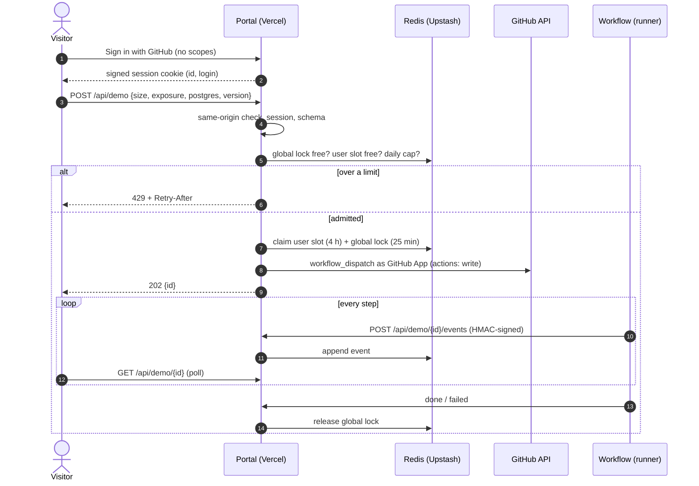

The [live demo](/demo) lets a visitor pick a few options and watch the whole
platform get built and verified on a fresh cluster. It is the one part of the
portal that spends real compute, so it is designed defensively.

## Flow

## Controls

| Risk | Control |
|---|---|
| Anonymous abuse | GitHub sign-in required; one run per account every 4 hours |
| Many accounts | one run at a time globally; 15 runs per day in total |
| Stuck runs | the global lock expires after 25 minutes on its own |
| Input injection | portal accepts four fixed choices (zod, strict); the workflow takes them as `choice` inputs, re-checks them, and only reads them from environment variables |
| Forged progress | callbacks carry an HMAC-SHA256 over `timestamp.body`; ±5 min replay window; schema-bounded payloads |
| CSRF | `Origin` must match the host; session cookie is `SameSite=Lax`, `HttpOnly`, `Secure` |
| Token exposure | the OAuth access token is used once to read the public profile and discarded; the GitHub App token is short-lived and scoped to `actions: write` on this repository |
| Runner terms | the demo only builds and tests this repository's own platform |

All of the above is covered by unit and route tests in `portal/test/`.
